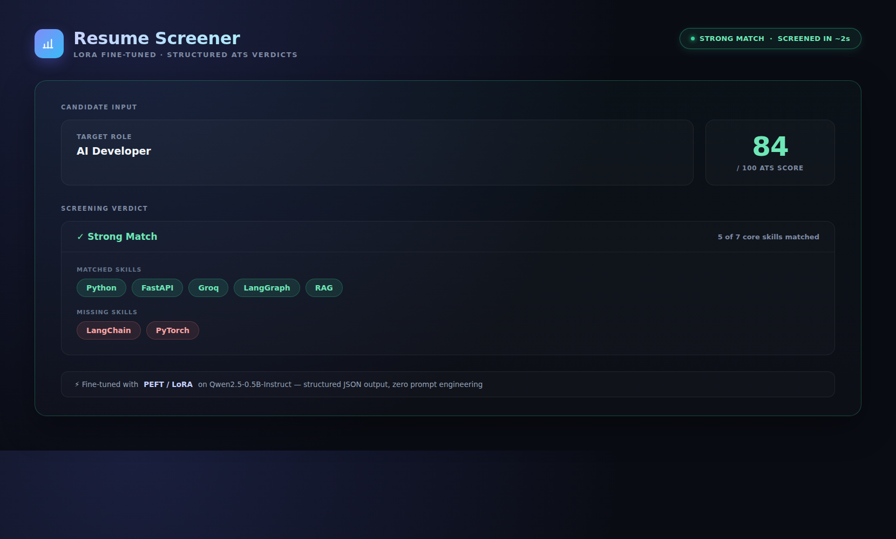

# Resume Screener: LoRA Fine-Tuned Qwen2.5-0.5B

[](https://resume-screener-finetune.onrender.com/)
[](https://github.com/ayush-s-tomar/resume-screener-lora/actions/workflows/eval.yml)
[](requirements.txt)
[](finetune_lora.ipynb)
[](LICENSE)

A small open model, fine-tuned with LoRA to return **structured JSON verdicts** for resume screening by default, instead of relying on prompt engineering to coax them out.

### 🌐 [Try the live demo →](https://resume-screener-finetune.onrender.com/)

> **Heads-up:** the demo runs on Render's free tier, so the first request can take 20 to 30 seconds to wake up. The demo also **serves a different model** (Groq-hosted) than the one trained here. See the [Deployment Note](#deployment-note).


<details>
<summary><b>📷 Screenshot and 🎥 full video walkthrough</b></summary>
<br/>

https://github.com/user-attachments/assets/3328d75d-4e17-41aa-95d9-09d8749e6c41

<br/>



</details>

---

## TL;DR

- 🎯 **Structure from training, not prompting.** The base model answers in free-form prose; the fine-tuned model returns parseable JSON with no special prompting.
- 📉 **Validation tracked training.** Validation loss fell from 0.2784 to 0.1714 over 3 epochs, staying close to training loss throughout (full table in [Results](#results)).
- ⚡ **0.44% of weights trained.** LoRA (r=16) on the q/k/v/o projections: 2.16M of 496M parameters, on a free Colab T4.
- 🔍 **Demo vs. artifact, stated plainly.** The trained adapter runs locally with no API key; the hosted demo uses a Groq model for hosting reasons.

**Jump to:** [Why](#why) · [Approach](#approach) · [Results](#results) · [Run Locally](#run-locally) · [Deployment Note](#deployment-note) · [Limitations](#known-limitations) · [Stack](#stack)

---

## Why

Prompting a base instruct model to screen resumes yields inconsistent prose, which you can't pipe into an ATS or scoring pipeline. Fine-tuning a small model makes the JSON verdict its default behavior, so downstream code can rely on the output shape.

---

## Approach

| | |
|---|---|
| **Base model** | Qwen2.5-0.5B-Instruct |
| **Method** | LoRA: r=16, alpha=32, dropout=0.05, targeting q/k/v/o projections |
| **Trainable params** | 2,162,688 / 496,195,456 (**0.44%**) |
| **Data** | 800 train / 96 eval examples, resume text → structured JSON verdict |
| **Training** | 3 epochs on a free Colab T4 GPU |

LoRA trains a tiny fraction of the weights, which is what makes this feasible on free-tier hardware. The full run is in [`finetune_lora.ipynb`](finetune_lora.ipynb).

---

## Results

| Epoch | Training Loss | Validation Loss |
|:-----:|:-------------:|:---------------:|
| 1 | 0.4078 | 0.2784 |
| 2 | 0.1956 | 0.1883 |
| 3 | 0.1713 | 0.1714 |

Validation loss stayed close to training loss with no divergence, which suggests the model learned the verdict format and screening pattern rather than memorizing examples.

### Before vs. after

**Prompt:** *Screen this resume for a Backend Engineer position and return a structured verdict. Resume: Bachelor's in CS, 4 years distributed backend experience, skilled in Python, PostgreSQL, Docker, Kubernetes.*

**Base model:** unstructured prose with markdown headers (Summary, Key Skills, Experience). Not machine-parseable.

**Fine-tuned model:**

```json
{
  "role": "Backend Engineer",
  "ats_score": 57,
  "verdict": "moderate_match",
  "matched_skills": ["Python", "PostgreSQL", "Docker", "Kubernetes"],
  "missing_skills": ["Java", "REST APIs", "Redis"],
  "years_experience": 4
}
```

*CI note: the eval workflow badge validates the training/eval pipeline in this repo, not the hosted demo backend.*

---

## Run Locally

Uses the trained LoRA adapter on top of the base Qwen2.5-0.5B-Instruct model from Hugging Face. **No API keys required.**

```bash
git clone https://github.com/ayush-s-tomar/resume-screener-lora.git
cd resume-screener-lora

python -m venv venv
source venv/bin/activate        # Windows: venv\Scripts\activate
pip install -r requirements.txt
```

```bash
# Run a built-in example resume and print the JSON verdict
python inference.py

# Screen your own resume (file path or raw text via --resume)
python inference.py --role "Backend Engineer" --resume path/to/resume.txt

# Optional: base vs. fine-tuned, side by side
python compare_baseline_vs_finetuned.py
```

---

## Repo Structure

```text
resume-screener-lora/
├── finetune_lora.ipynb                # Training notebook: data prep → LoRA config → training → eval
├── inference.py                       # CLI: loads adapter, runs one screening (--resume / --role)
├── compare_baseline_vs_finetuned.py   # Side-by-side base vs. fine-tuned output
├── data/                              # Train/eval JSONL datasets + generator script
├── resume-screener-lora-adapter/      # Trained LoRA adapter weights
├── render-deploy/                     # Hosted demo backend (see its README)
├── assets/                            # Demo GIF and screenshot
├── .github/workflows/                 # CI eval workflow (push/PR)
├── requirements.txt
├── LICENSE
└── README.md
```

---

## Deployment Note

The **trained LoRA adapter** is the actual research artifact and runs fully locally. The **hosted demo** instead scores resumes through Groq's API (`openai/gpt-oss-20b`), not the GGUF-quantized adapter. This was a deliberate substitution after repeated OOM and timeout failures running llama.cpp inference on Render's free tier (512 MB RAM ceiling), and it keeps the public link fast and reliably hosted.

The results above reflect the real fine-tuned model, so **don't judge the fine-tuning by the demo's output.** Setup details for the hosted backend are in [`render-deploy/README.md`](render-deploy/README.md).

---

## Known Limitations

- **Small eval set.** 96 held-out examples is enough to show the loss trend, but not to treat the exact values as a tight benchmark.
- **Tiny base model, by design.** Qwen2.5-0.5B was chosen so LoRA training fits on a free Colab T4. A larger base would likely handle more nuanced resumes better, at the cost of real GPU budget.
- **Demo ≠ trained model.** See the [Deployment Note](#deployment-note).

---

## Stack

| Layer | Technology |
|---|---|
| Fine-tuning | PEFT/LoRA, Hugging Face Transformers, TRL, PyTorch, Colab T4 |
| Local inference | CLI scripts (`inference.py`, `compare_baseline_vs_finetuned.py`) |
| Hosted demo | FastAPI, Groq API, Render |

---

## Contributing

Issues and pull requests are welcome. Check the [issues page](https://github.com/ayush-s-tomar/resume-screener-lora/issues), then fork the repo, create a feature branch, and open a PR.

## License

MIT. See [`LICENSE`](LICENSE).

## Author

**Ayush Singh Tomar**: [GitHub](https://github.com/ayush-s-tomar) · [LinkedIn](https://www.linkedin.com/in/ayushsinghtomar) · [Portfolio](https://ayush-s-tomar.vercel.app)

*Part of my AI developer portfolio: agents and models that do real, measurable work. See also [SalesAgent](https://github.com/ayush-s-tomar/salesagent), an autonomous B2B lead-research and outreach agent.*
