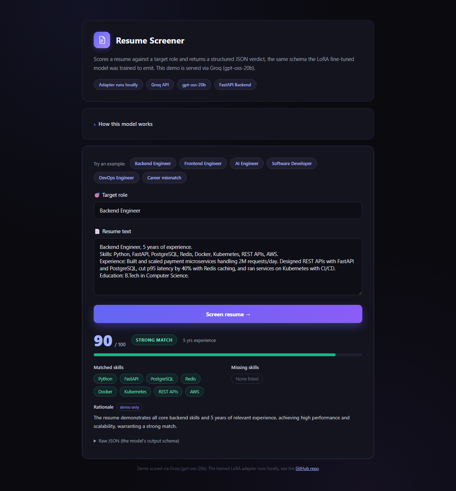

# Resume Screener: LoRA Fine-Tuned Qwen2.5-0.5B

[](https://resume-screener-finetune.onrender.com/)
[](https://github.com/ayush-s-tomar/resume-screener-lora/actions/workflows/eval.yml)
[](https://github.com/ayush-s-tomar/resume-screener-lora/actions/workflows/tests.yml)
[](requirements.txt)
[](finetune_lora.ipynb)
[](LICENSE)

A small open model, fine-tuned with LoRA to return **structured JSON verdicts** for resume screening by default, instead of relying on prompt engineering to coax them out.

### 🌐 [Try the live demo →](https://resume-screener-finetune.onrender.com/)

Run the actual fine-tuned adapter yourself (free GPU, about 2 minutes): [](https://colab.research.google.com/github/ayush-s-tomar/resume-screener-lora/blob/main/demo_colab.ipynb)

> **Heads-up:** the demo runs on Render's free tier, so the first request can take 20 to 30 seconds to wake up. The demo also **serves a different model** (Groq-hosted) than the one trained here. See the [Deployment Note](#deployment-note), or run the real adapter in the [Colab notebook](https://colab.research.google.com/github/ayush-s-tomar/resume-screener-lora/blob/main/demo_colab.ipynb).


<details>
<summary><b>📷 Screenshot and 🎥 full video walkthrough</b></summary>
<br/>

https://github.com/user-attachments/assets/3328d75d-4e17-41aa-95d9-09d8749e6c41

<br/>



</details>

---

## TL;DR

- 🎯 **Accuracy from training, not prompting.** On 96 held-out examples, verdict accuracy was 17.7% zero-shot, 18.8% with the score ranges added to the prompt, and 88.5% after fine-tuning; mean score error was 32.0, 35.1 and 5.4 points respectively. A larger prompted model (gpt-oss-20b on Groq, same prompt and score ranges) reached 55.2% and 16.4.
- 📉 **Validation tracked training.** Validation loss fell from 0.2784 to 0.1714 over 3 epochs, staying close to training loss throughout (full table in [Results](#results)).
- ⚡ **0.44% of weights trained.** LoRA (r=16) on the q/k/v/o projections: 2.16M of 496M parameters, on a free Colab T4.
- 🔍 **Demo vs. artifact, stated plainly.** The trained adapter runs locally with no API key; the hosted demo uses a Groq model for hosting reasons.

**Jump to:** [Why](#why) · [Approach](#approach) · [Results](#results) · [Run Locally](#run-locally) · [Deployment Note](#deployment-note) · [Limitations](#known-limitations) · [Stack](#stack)

---

## Why

A base instruct model given a loose prompt answers resume screening in inconsistent prose, and even with an explicit JSON-schema prompt its verdicts match the target rubric only 17.7% of the time (18.8% with the score ranges in the prompt too), so you can't pipe it into an ATS or scoring pipeline. Fine-tuning a small model makes the JSON verdict its default behavior and lifts rubric agreement to 88.5%, so downstream code can rely on both the output shape and the scores.

---

## Approach

| | |
|---|---|
| **Base model** | Qwen2.5-0.5B-Instruct |
| **Method** | LoRA: r=16, alpha=32, dropout=0.05, targeting q/k/v/o projections |
| **Trainable params** | 2,162,688 / 496,195,456 (**0.44%**) |
| **Data** | 800 train / 96 eval examples (synthetic, generated by `data/generate_dataset.py`), resume text → structured JSON verdict |
| **Training** | 3 epochs on a free Colab T4 GPU |

LoRA trains a tiny fraction of the weights, which is what makes this feasible on free-tier hardware. The full run is in [`finetune_lora.ipynb`](finetune_lora.ipynb).

---

## Results

| Epoch | Training Loss | Validation Loss |
|:-----:|:-------------:|:---------------:|
| 1 | 0.4078 | 0.2784 |
| 2 | 0.1956 | 0.1883 |
| 3 | 0.1713 | 0.1714 |

Validation loss stayed close to training loss with no divergence, which suggests the model learned the verdict format and screening pattern rather than memorizing examples.

### Held-out evaluation (96 examples)

| Metric | Zero-shot base | Zero-shot + rubric | Fine-tuned | gpt-oss-20b + rubric (Groq, prompted) |
|---|---|---|---|---|
| Valid JSON rate | 100% | 100% | 100% | 100% |
| Verdict accuracy | 17.7% (17/96) | 18.8% (18/96) | 88.5% (85/96) | 55.2% (53/96) |
| Mean absolute score error | 32.0 | 35.1 | 5.4 | 16.4 |

Telling the baseline the verdict score ranges (measured on the training set only) does not help: it reaches 18.8% verdict accuracy and a mean score error of 35.1, no better than without them. The 0.5B base model cannot apply the rubric from the prompt alone, while fine-tuning reaches 88.5% verdict accuracy and a mean score error of 5.4. All configurations are prompted with, or trained on, the same JSON schema, so the comparison is about correctness rather than output format. Reproduce with `python compare_baseline_vs_finetuned.py`; raw numbers are in `comparison_results.json`.

The last column is a larger prompted model rather than a fine-tuned one: `openai/gpt-oss-20b` on Groq, with the same system prompt, score ranges and inputs as the rubric baseline and no fine-tuning. It reaches 55.2% verdict accuracy and a mean score error of 16.4; the fine-tuned 0.5B adapter still leads on verdict accuracy (88.5% vs 55.2%), and the adapter has the lower mean score error (5.4 vs 16.4 points). The trade-off is different, though: a hosted 20B model costs an API call per resume and needs network access, while the 0.5B adapter runs locally. Because the labels come from the generator's own rubric, the gap measures how well each model learned that rubric, not screening quality in general. Reproduce with `python eval_groq_baseline.py` (needs `GROQ_API_KEY`); raw numbers are in `groq_baseline_results.json`.

<!-- lat-start -->
### Cost and latency

Accuracy is only half of the trade-off between the adapter and the hosted 20B model, so I measured the rest on one Windows machine (CPU only, 16 logical cores, 12 torch threads). The hosted column is end to end through the live demo, which scores with gpt-oss-20b on Groq, so it includes the network. Accuracy is from the held-out evaluation above.

| | Fine-tuned 0.5B adapter (local) | gpt-oss-20b on Groq (hosted demo) |
|---|---|---|
| Verdict accuracy (96 held-out) | 88.5% | 55.2% |
| Median latency per resume | 11.4 s (p90 13.7 s) | 3.4 s (p90 5.5 s) |
| Needs network and an API key | no | yes |
| On disk | 953 MB base + 8.3 MB adapter | none |
| Memory while running | 2.2 GB resident | none |
| Quantized GGUF | resume-screener-q4_k_m.gguf: 379 MB | none |

The hosted call was faster per resume than the CPU-only adapter (3.4 s against 11.4 s), so the adapter's case is accuracy on this task, working offline and having no dependency on an API key or rate limits, not speed. A GPU would speed up the local adapter. These are single-machine timings of 12 resumes locally and 5 hosted requests, not a rigorous benchmark. Reproduce with `python benchmark_latency.py`; raw numbers are in `results/latency_v1.json`.
<!-- lat-end -->

With 96 examples, the 95% (Wilson) intervals on verdict accuracy are 11-27% zero-shot, 12-28% with the rubric, 45-65% for gpt-oss-20b and 81-93% fine-tuned; the fine-tuned interval does not overlap any of the others, so the gap is not sampling noise, although the exact values are still imprecise.

### Sanity check on hand-written resumes

The generator's resumes follow templates, so I also ran six hand-written resumes (the demo's example buttons) through the hosted demo and the local adapter. This is a sanity check on six examples, not an evaluation.

| Resume | Hosted demo (Groq) | Local adapter |
|---|---|---|
| Backend Engineer, 5 yrs | 90, strong_match | 68, moderate_match |
| Frontend Engineer, 2 yrs | 60, moderate_match | 49, weak_match |
| AI Engineer, 3 yrs | 85, strong_match | 64, moderate_match |
| Software Developer, fresher | 70, moderate_match | 48, weak_match |
| DevOps Engineer, career switcher | 70, moderate_match | 58, moderate_match |
| Graphic designer for Backend Engineer | 10, weak_match | 28, weak_match |

Both rank the resumes in a broadly similar order (Backend and AI at the top) and both reject the graphic designer, but the adapter is more conservative: it never returns `strong_match` here and puts two mid-level resumes in `weak_match`. A plausible explanation, not tested, is that it learned the score distribution of the synthetic generator, which hand-written resumes do not follow. Adding varied, human-written resumes to the training data is the obvious next step.

<!-- hw-start -->
### Hand-authored test set (36 resumes)

The generator's resumes follow templates, so I also wrote a separate test set: 36 resumes in 6 roles (two strong, two moderate and two weak matches per role) in three layouts (prose, labelled lines, headed bullets), labelled with the written rubric in [`data/HANDWRITTEN_RUBRIC.md`](data/HANDWRITTEN_RUBRIC.md): core-skill coverage, years against what the role typically needs, and field match. The resumes and labels were drafted with an AI assistant against that rubric and have not been checked by professional recruiters, so this is a development set, not a benchmark. Data: `data/handwritten_eval.jsonl`; reproduce with `python eval_adapter.py --adapter resume-screener-lora-adapter --data data/handwritten_eval.jsonl --out results/handwritten_v1.json`.

| Metric | Adapter v1 |
|---|---|
| Verdict accuracy | 44.4% (16/36) |
| Severe errors (weak vs strong confusions) | 2 of 36 |
| Pairwise ordering (higher-labelled resume scores higher) | 80.4% |

Rows are the rubric label, columns the adapter's verdict:

| | weak | moderate | strong | invalid |
|---|---|---|---|---|
| weak | 11 | 1 | 0 | 0 |
| moderate | 10 | 2 | 0 | 0 |
| strong | 2 | 6 | 3 | 1 |
<!-- hw-end -->

<!-- ns-start -->
### Name-swap sensitivity

Does the adapter react to who the candidate is? I took 15 held-out resumes (balanced across weak, moderate and strong matches), put a name at the top of each resume text, and compared the adapter's score and verdict with the same resume without a name. The eight names were picked to cover a range of common name origins, a coarse probe rather than a demographic classification. A neutral placeholder ("Candidate A") is the control for the effect of adding any prefix at all.

| Prefix | Mean score shift (95% CI) | Verdict flips |
|---|---|---|
| Candidate A (control) | +0.4 (-0.2 to +1.0) | 0/15 |
| Emily Walsh | +0.7 (-0.2 to +1.6) | 0/15 |
| Greg Baker | -0.3 (-1.7 to +1.2) | 0/15 |
| Lakisha Washington | +0.1 (-1.3 to +1.6) | 1/15 |
| Jamal Robinson | +0.7 (-0.2 to +1.6) | 0/15 |
| Priya Sharma | +0.4 (-0.2 to +1.0) | 0/15 |
| Rahul Verma | -0.1 (-1.4 to +1.1) | 1/15 |
| Mei Chen | +0.0 (-1.7 to +1.7) | 0/15 |
| Mohammed Hassan | +0.1 (-1.3 to +1.6) | 1/15 |

Across the 8 names the mean absolute score change was 0.9 points (largest single change 10) and 3 of 120 verdicts flipped; the control placeholder moved scores by 0.4 points on average, which is the noise floor for adding any prefix. No name moved scores systematically: every 95% interval includes 0. All 3 verdict flips came from one resume whose base score (76, strong match) sits 1.5 points from the strong/moderate boundary: 3 of the 8 names moved it by 8 points, while the control placeholder did not. That makes it a boundary case rather than a pattern, but one resume cannot separate sensitivity to any prefix from sensitivity to particular names. This is a sensitivity check on 15 resumes and 8 names, not a fairness audit: names are one proxy among many, the sample is small, and the adapter is only evaluated on this synthetic data. Reproduce with `python name_swap_test.py`; raw numbers are in `results/name_swap_v1.json`.
<!-- ns-end -->

### Before vs. after

**Prompt:** *Screen this resume for a Backend Engineer position and return a structured verdict. Resume: Bachelor's in CS, 4 years distributed backend experience, skilled in Python, PostgreSQL, Docker, Kubernetes.*

**Base model:** unstructured prose with markdown headers (Summary, Key Skills, Experience) when given only a loose "structured verdict" prompt. Not machine-parseable. (With the explicit JSON-schema prompt used in the held-out evaluation above, the base model also returns valid JSON, but its verdicts are far less accurate.)

**Fine-tuned model:**

```json
{
  "role": "Backend Engineer",
  "ats_score": 56,
  "verdict": "moderate_match",
  "matched_skills": ["Python", "PostgreSQL", "Docker", "Kubernetes"],
  "missing_skills": ["Java", "REST APIs", "Redis"],
  "years_experience": 4
}
```

*CI note: the eval workflow badge validates the training/eval pipeline in this repo, not the hosted demo backend.*

---

## Run Locally

Uses the trained LoRA adapter on top of the base Qwen2.5-0.5B-Instruct model from Hugging Face. **No API keys required.** The adapter is also published on the Hugging Face Hub: [Kus-hal/resume-screener-lora](https://huggingface.co/Kus-hal/resume-screener-lora), with a GGUF-quantized build at [Kus-hal/resume-screener-gguf](https://huggingface.co/Kus-hal/resume-screener-gguf).

```bash
git clone https://github.com/ayush-s-tomar/resume-screener-lora.git
cd resume-screener-lora

python -m venv venv
source venv/bin/activate        # Windows: venv\Scripts\activate
pip install -r requirements.txt
```

```bash
# Run a built-in example resume and print the JSON verdict
python inference.py

# Screen your own resume (file path or raw text via --resume)
python inference.py --role "Backend Engineer" --resume path/to/resume.txt

# Optional: re-run the held-out evaluation (slow on CPU)
python compare_baseline_vs_finetuned.py

# Optional: the same eval with a larger prompted model (needs GROQ_API_KEY)
python eval_groq_baseline.py
```

To load the adapter straight from the Hub instead of a local clone:

```python
from peft import PeftModel
from transformers import AutoModelForCausalLM, AutoTokenizer

base = AutoModelForCausalLM.from_pretrained("Qwen/Qwen2.5-0.5B-Instruct")
model = PeftModel.from_pretrained(base, "Kus-hal/resume-screener-lora")
tokenizer = AutoTokenizer.from_pretrained("Qwen/Qwen2.5-0.5B-Instruct")
```

---

## Repo Structure

```text
resume-screener-lora/
├── finetune_lora.ipynb                # Training notebook: data prep → LoRA config → training → eval
├── inference.py                       # CLI: loads adapter, runs one screening (--resume / --role)
├── compare_baseline_vs_finetuned.py   # Held-out eval: zero-shot vs. zero-shot + rubric vs. fine-tuned
├── eval_groq_baseline.py             # Same eval with a larger prompted model (gpt-oss-20b on Groq)
├── data/                              # Train/eval JSONL datasets + generator script
├── resume-screener-lora-adapter/      # Trained LoRA adapter weights
├── render-deploy/                     # Hosted demo backend (see its README)
├── assets/                            # Demo GIF and screenshot
├── .github/workflows/                 # CI eval workflow (push/PR)
├── requirements.txt
├── LICENSE
└── README.md
```

---

## Deployment Note

The **trained LoRA adapter** is the actual research artifact and runs fully locally. The **hosted demo** instead scores resumes through Groq's API (`openai/gpt-oss-20b`), not the GGUF-quantized adapter. This was a deliberate substitution after repeated OOM and timeout failures running llama.cpp inference on Render's free tier (512 MB RAM ceiling), and it keeps the public link fast and reliably hosted.

The results above reflect the real fine-tuned model, so **don't judge the fine-tuning by the demo's output.** Setup details for the hosted backend are in [`render-deploy/README.md`](render-deploy/README.md).

---

## Known Limitations

- **Small eval set.** 96 held-out examples is enough to show the loss trend and the size of the accuracy gap, but not to treat the exact values as a tight benchmark.
- **Labels come from the repo's dataset generator.** Verdict accuracy measures agreement with that rubric (`data/generate_dataset.py`), not agreement with human recruiters.
- **The main baselines are the same 0.5B model.** The last column of the evaluation table is a larger prompted model (gpt-oss-20b on Groq, 55.2% verdict accuracy), so the claim is about what a small fine-tuned local model can do, not that prompting cannot work.
- **Skill lists track the generator's.** On the 96 held-out examples, `matched_skills` agree with the generator's lists with F1 1.00 and `missing_skills` with F1 0.91 (exact-set match 100% and 71.9%). 4.3% of the skills it lists as missing appear in the resume text and 0% of the ones it lists as matched do not (approximate string check; the generator's own lists score 5% and 0%). Reproduce with `python eval_skill_lists.py`. This is still agreement with synthetic labels, and out-of-distribution input is harder: a Colab run on a hand-written resume listed REST APIs and AWS as missing although the resume names both.
- **Tiny base model, by design.** Qwen2.5-0.5B was chosen so LoRA training fits on a free Colab T4. A larger base would likely handle more nuanced resumes better, at the cost of real GPU budget.
- **Demo ≠ trained model.** See the [Deployment Note](#deployment-note).

---

## Stack

| Layer | Technology |
|---|---|
| Fine-tuning | PEFT/LoRA, Hugging Face Transformers, TRL, PyTorch, Colab T4 |
| Local inference | CLI scripts (`inference.py`, `compare_baseline_vs_finetuned.py`) |
| Hosted demo | FastAPI, Groq API, Render |

---

## Contributing

Issues and pull requests are welcome. Check the [issues page](https://github.com/ayush-s-tomar/resume-screener-lora/issues), then fork the repo, create a feature branch, and open a PR. Run the unit tests first (`pip install pytest httpx groq`, then `pytest`).

## License

MIT. See [`LICENSE`](LICENSE).

## Author

**Ayush Singh Tomar**: [GitHub](https://github.com/ayush-s-tomar) · [LinkedIn](https://www.linkedin.com/in/ayushsinghtomar) · [Portfolio](https://ayush-s-tomar.vercel.app)

*Part of my AI developer portfolio: agents and models that do real, measurable work. See also [SalesAgent](https://github.com/ayush-s-tomar/salesagent), an autonomous B2B lead-research and outreach agent.*
